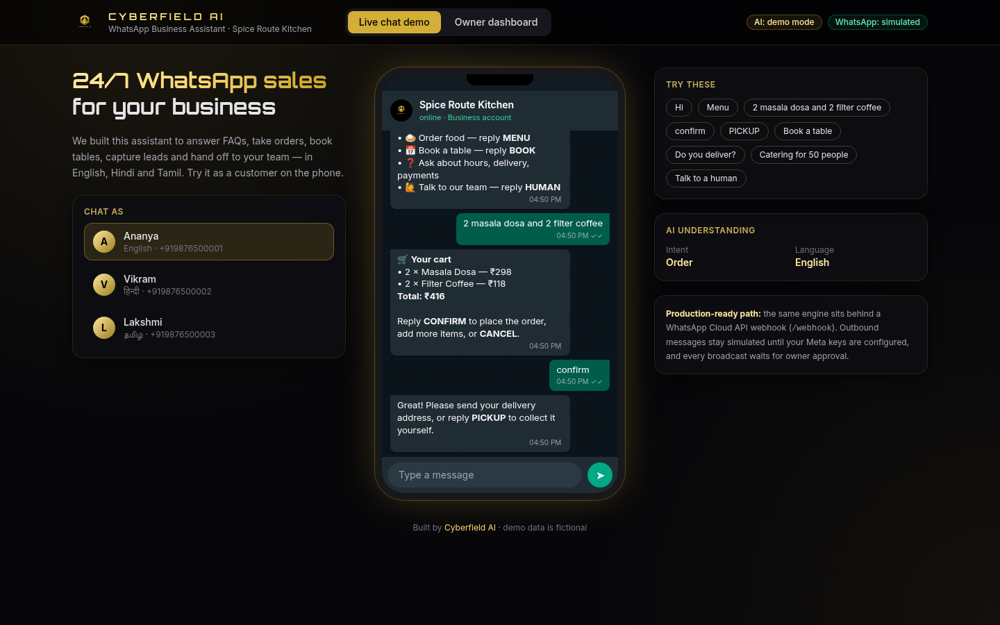
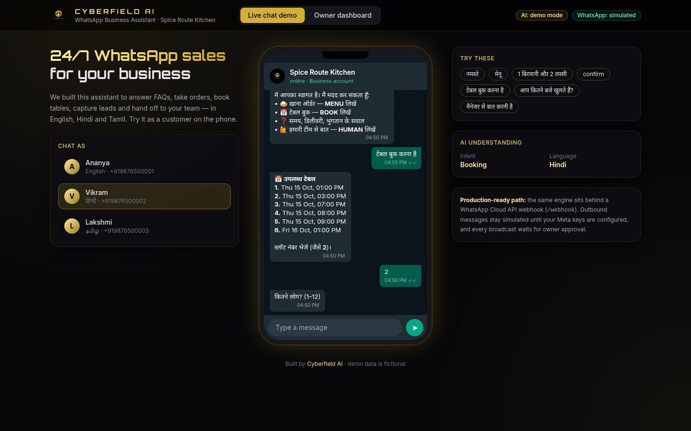
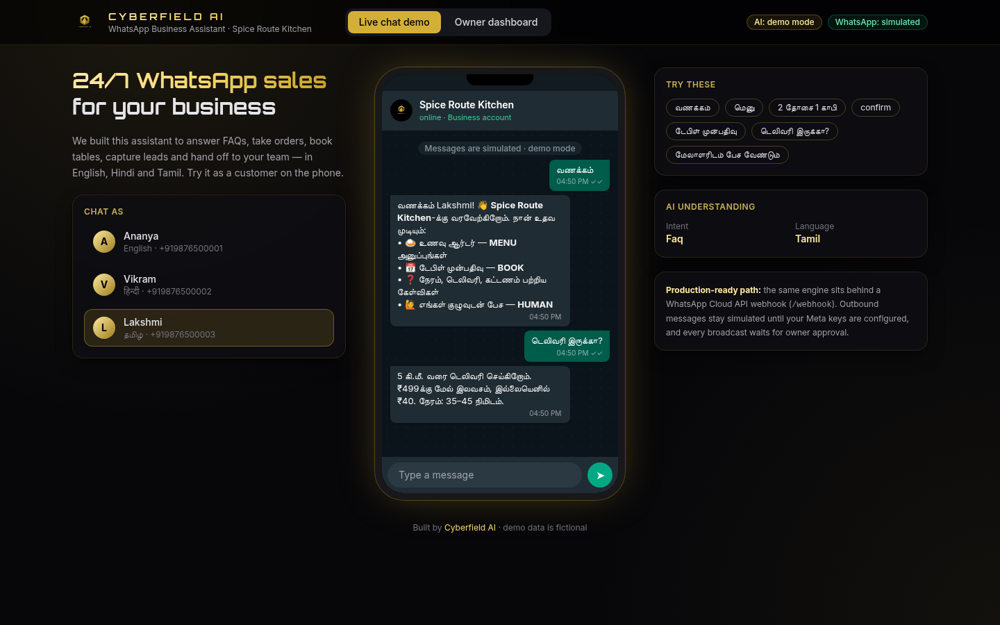
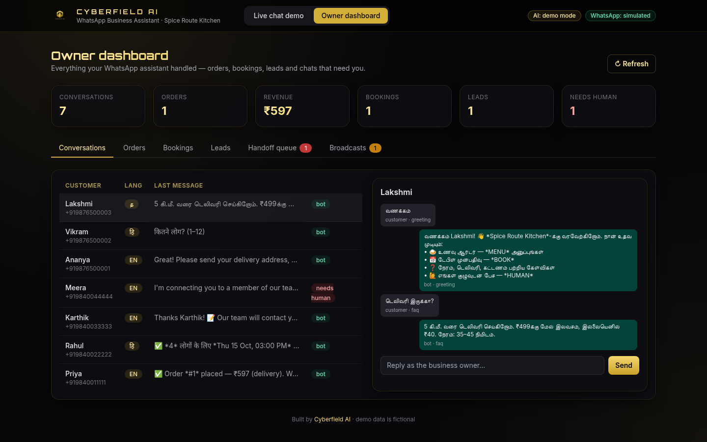
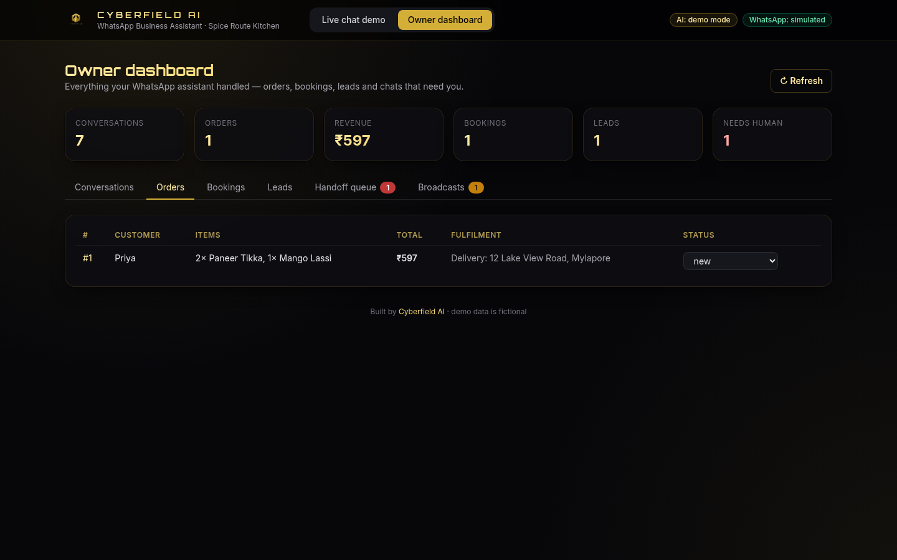
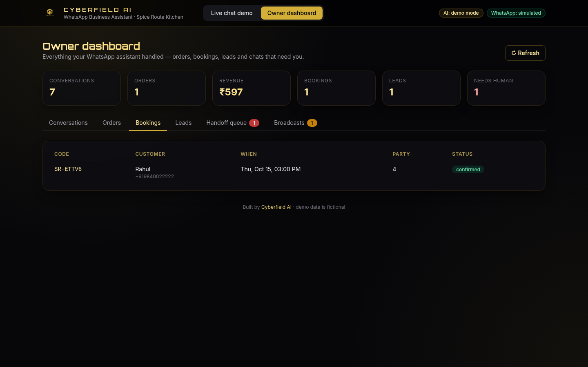
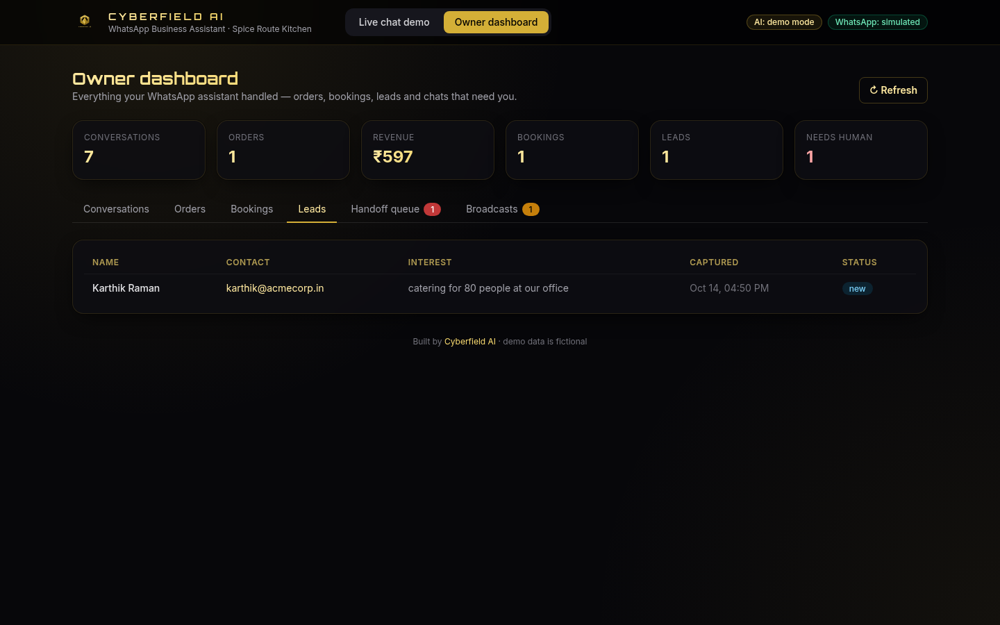
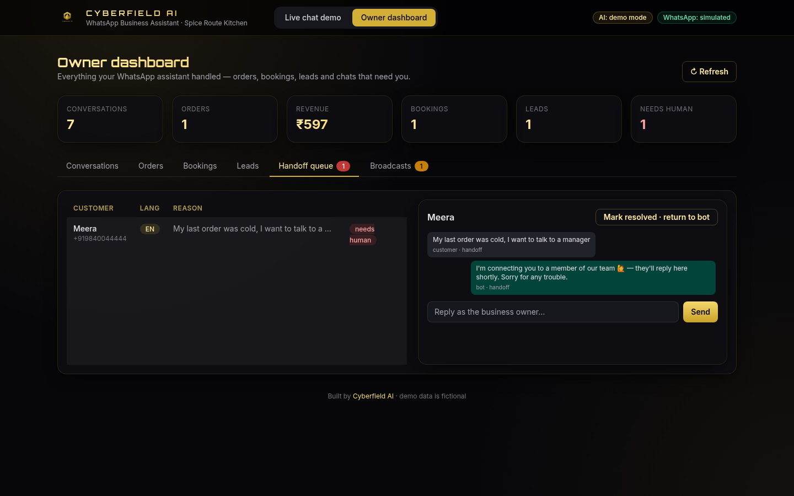
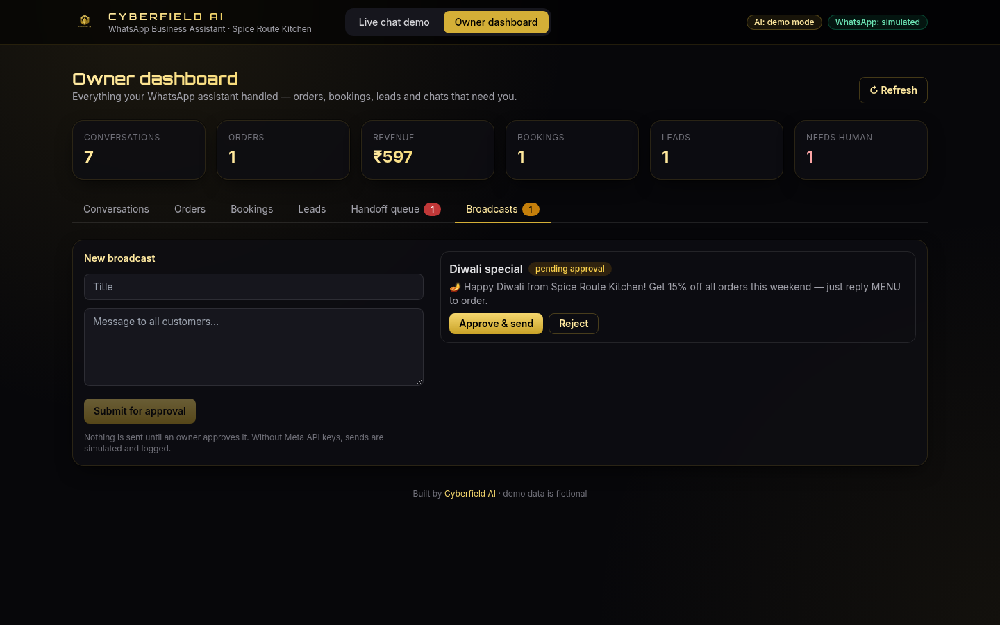

<p align="center"></p>
<h1 align="center">Cyberfield AI · WhatsApp Business Assistant</h1>
<p align="center"><b>An AI assistant that answers customers, takes orders, books tables and captures leads on WhatsApp — in English, Hindi and Tamil.</b><br/>
Runs locally in demo mode with zero API keys. Plug in your own LLM and WhatsApp Cloud API keys when you're ready to go live.</p>

---

We're **Cyberfield AI**, a three-person AI agency. We built this demo to show what we deliver for restaurants, clinics and retail shops: a WhatsApp assistant your customers actually enjoy using, plus a dashboard your team can run the business from.

The demo business is **Spice Route Kitchen**, a fictional Chennai restaurant. All names, numbers and orders are made up.



## What it does

| Capability | How it works |
|---|---|
| 💬 **FAQ answers** | A small knowledge base (hours, location, delivery, payments, veg/Jain, parking) with answers in each language |
| 🛒 **Order taking** | Free-text items and quantities ("2 masala dosa and 1 coffee"), a running cart, *CONFIRM*, then delivery address or *PICKUP* |
| 📅 **Bookings** | Shows real open slots, takes party size, checks capacity, issues a booking code |
| 📝 **Lead capture** | Catering, event and bulk enquiries: picks up name + email/phone and adds the lead to the dashboard |
| 🙋 **Human handoff** | "Talk to a manager" or a complaint pauses the bot and puts the chat in the handoff queue. The owner replies from the dashboard, then hands the chat back to the bot |
| 🌐 **Multilingual** | Detects English, Hindi (Devanagari or romanised) and Tamil (script or romanised) and replies in the same language |
| 📣 **Broadcasts with approval** | Every broadcast starts as *pending approval*. Nothing goes out until an owner approves it |
| 🔌 **WhatsApp Cloud API webhook** | `GET /webhook` handles verify-token checks and `POST /webhook` parses Meta's inbound payload. Sending stays **simulated** unless your keys are set |
| 🧠 **Optional LLM** | Questions the rules can't answer go to any OpenAI-compatible model, grounded in the knowledge base |

| Hindi booking | Tamil FAQ |
|---|---|
|  |  |

### Owner dashboard


| Orders | Bookings |
|---|---|
|  |  |
| **Leads** | **Handoff queue** |
|  |  |



## Run it on Windows (about 5 minutes)

You need **Python 3.10+** and **Node.js 18+** installed.

1. Download or clone this repo, then open the folder.
2. Double-click **`run.bat`**. On first run it creates a virtual environment, installs dependencies and builds the UI.
3. Open **http://127.0.0.1:8000**.

Or do it by hand in PowerShell:

```powershell
python -m venv .venv
.venv\Scripts\activate
pip install -r requirements.txt
cd frontend; npm install; npm run build; cd ..
cd backend; python -m uvicorn app.main:app --port 8000
```

To develop the UI with hot reload, keep the backend running and run `cd frontend; npm run dev`, then open http://localhost:5173.

To reset the demo data, delete the `data` folder or `POST /api/reset`.

## Going live (optional)

Copy `.env.example` to `.env` and set your values as environment variables before you start the server (for example `set LLM_API_KEY=...` in cmd):

| Variable | Purpose |
|---|---|
| `LLM_API_KEY`, `LLM_BASE_URL`, `LLM_MODEL` | Any OpenAI-compatible endpoint (OpenAI, Groq, OpenRouter, Ollama…) |
| `WHATSAPP_VERIFY_TOKEN` | Token you enter in the Meta app's webhook settings (default `cyberfield-demo-token`) |
| `WHATSAPP_TOKEN`, `WHATSAPP_PHONE_NUMBER_ID` | Turns on real sending through the Graph API. Without them every outbound message is logged as `simulated` |

Point your Meta app's webhook at `https://<your-host>/webhook`. For local testing, a tunnel such as ngrok or cloudflared works.

## Tests

```powershell
python -m playwright install chromium   # first time only
python -m pytest -v                     # or double-click run_tests.bat
```

- `tests/test_api.py`: language detection, FAQ in three languages, order, booking, lead, handoff and owner-reply flows, broadcast approval gate, and webhook verify + inbound payload.
- `tests/test_smoke_playwright.py`: a browser smoke test against the built UI (needs `frontend/dist`).
- `python scripts/screenshots.py` regenerates the README screenshots.

## Project layout

```
backend/app/   main.py (API + webhook) · engine.py (language, intents, flows) · whatsapp.py · llm.py · seed.py · db.py (SQLite)
frontend/src/  Vite + React + TypeScript + Tailwind: phone simulator and owner dashboard
tests/         pytest API tests + Playwright smoke test
```

## Where we'd take it next for a client

WhatsApp interactive buttons and list messages, payment links (Razorpay/Stripe), dashboard login with roles, template-message management for broadcasts outside the 24-hour window, and a knowledge base editor.

---
**Cyberfield AI.** We build practical AI automations for small businesses. Want this for your business? Get in touch through our Upwork or Fiverr profile.
