<p align="center"></p>
<h1 align="center">Cyberfield AI · WhatsApp Business Assistant</h1>
<p align="center"><b>A WhatsApp assistant that answers customers, takes orders and payments, books appointments, captures leads, understands voice notes and photos, and hands off to your team, in English, Hindi and Tamil. One install runs several businesses.</b><br/>
Runs locally in demo mode with zero API keys. Add WhatsApp Cloud API, LLM, speech-to-text and Razorpay keys when you're ready to go live.</p>

---

We're **Cyberfield AI**, a three-person AI agency. We built this to show what we deliver for restaurants, clinics, salons and retail shops: a WhatsApp assistant customers enjoy using, plus a dashboard the owner can run the business from.

It comes with three fictional demo businesses: **Spice Route Kitchen** (restaurant), **Sunrise Family Clinic** (clinic) and **Glow Studio Salon** (salon). All names, numbers and orders are made up.

| Menu as a WhatsApp list | Cart with reply buttons | Order + payment link |
|---|---|---|
| 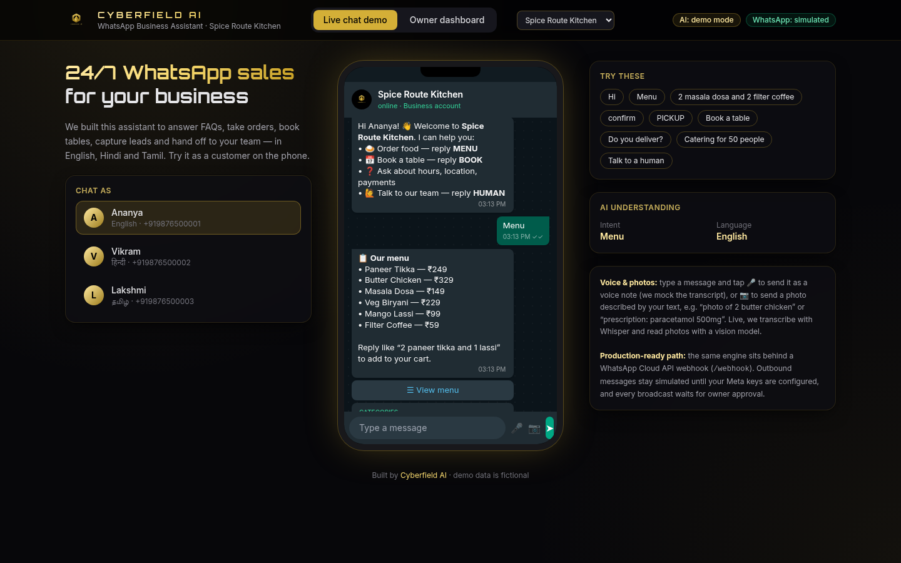 | 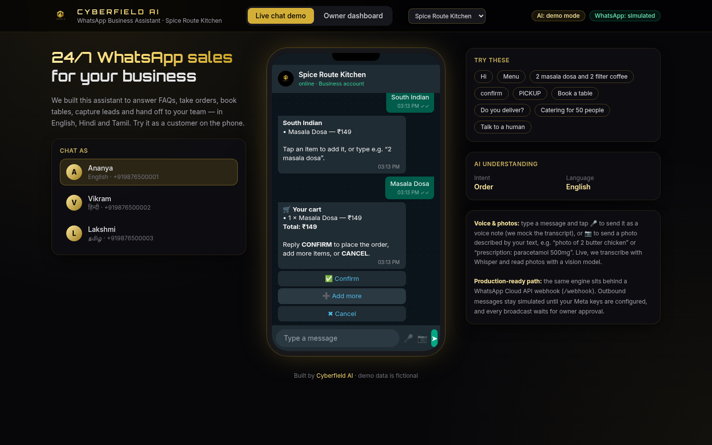 | 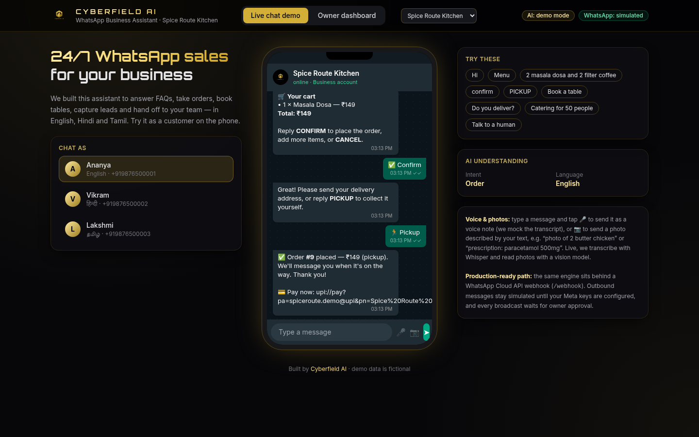 |

## What it does

| Capability | How it works |
|---|---|
| 💬 **FAQ answers** | Per-business knowledge base with answers in each language, editable from Settings |
| 🧠 **Grounded AI fallback** | Questions the rules can't answer go to any OpenAI-compatible model. The model sees **only** that business's FAQ, menu/services, prices and hours. If the answer isn't there, it refuses and offers a human instead of guessing |
| 🔘 **Interactive messages** | Menu categories, items and booking slots are sent as WhatsApp **list messages**, and confirm/cancel/pickup as **reply buttons**. Inbound `button_reply` / `list_reply` taps are handled. Typed replies still work |
| 🛒 **Orders + payments** | Free-text items ("2 masala dosa and 1 coffee"), a cart, confirm, delivery or pickup, then a **Razorpay Payment Link** (or a **UPI deep link** if Razorpay isn't set). Razorpay's signed webhook marks the order paid and thanks the customer |
| 📅 **Bookings** | Real open slots with capacity. Restaurants ask party size; clinics and salons book a service straight away. ⏰ Reminders go as free text inside WhatsApp's 24-hour window and as an approved **template** outside it |
| 🎤 **Voice notes** | Downloaded from the Graph API, transcribed with Whisper (OpenAI, Groq or any `/audio/transcriptions` endpoint), answered in the language spoken |
| 📷 **Photos** | Vision model reads product or menu photos into the cart. Prescriptions and anything unclear go to a human |
| 📝 **Lead capture** | Catering, events, bridal and bulk enquiries: name + email/phone go to the dashboard |
| 🙋 **Human handoff** | "Talk to a manager" or a complaint pauses the bot until the owner hands the chat back |
| 🌐 **Multilingual** | Detects English, Hindi and Tamil, in script or romanised. Each business picks the languages it offers |
| 🏢 **Multi-client** | Each business has its own WhatsApp number, token, FAQ, menu/services, hours, slots, templates, UPI ID and languages. Inbound messages are routed by `metadata.phone_number_id` |
| 📣 **Broadcasts with approval** | Nothing goes out until an owner approves. Outside the 24h window only an approved template is sent; customers who can't get either are skipped and counted |
| 📊 **Analytics** | Chats, orders, revenue (and how much was paid online), bookings, leads, missed questions, handoffs, a busy-hours chart and a 14-day trend |
| 🔐 **Production basics** | Dashboard login, Meta webhook signature check, idempotency by message id, send retries with backoff, sent/delivered/read/failed tracking, JSON logs, Docker + Render deploy |

| Hindi booking (slot list) | Tamil voice note | Photo → cart |
|---|---|---|
| 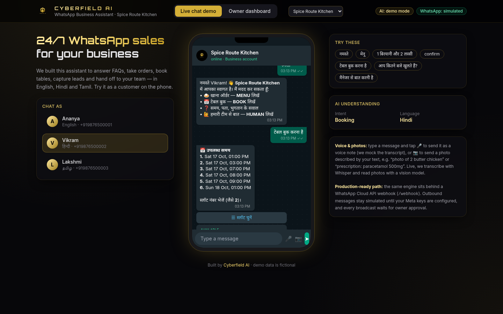 | 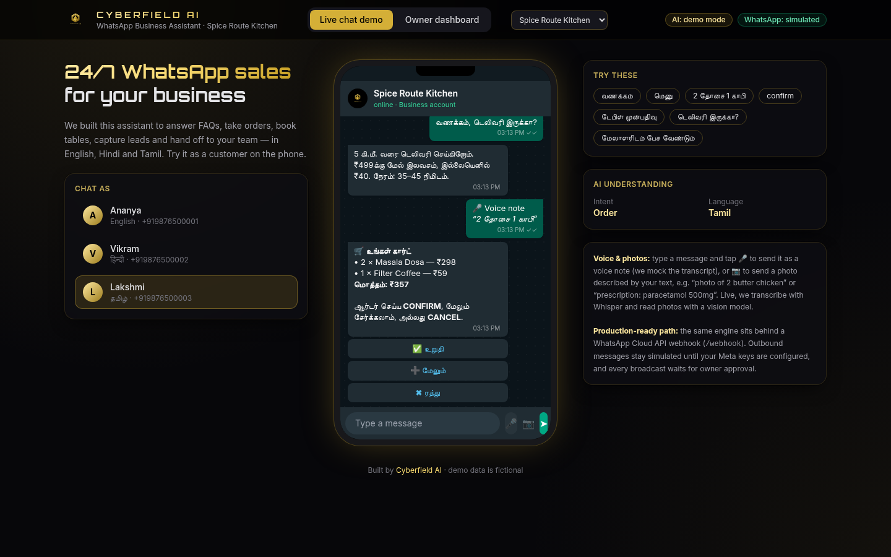 | 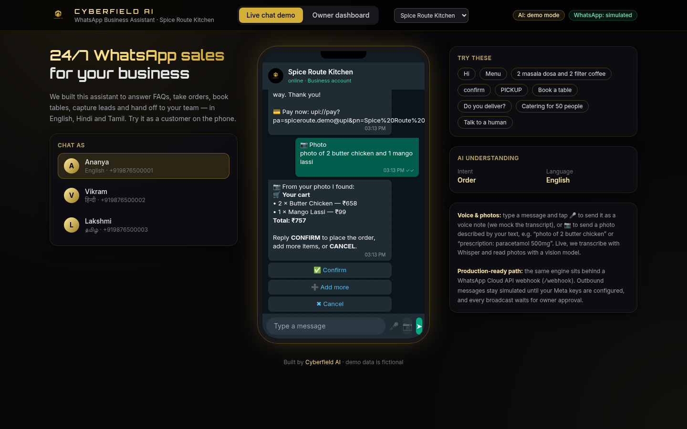 |

### Owner dashboard

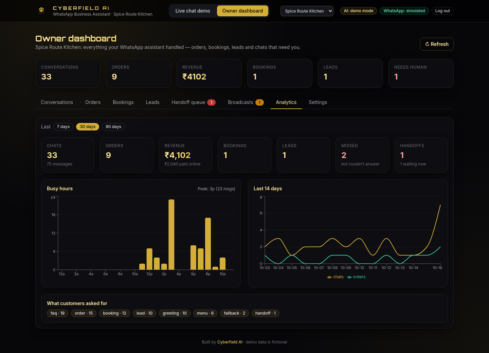

| Login | Conversations |
|---|---|
| 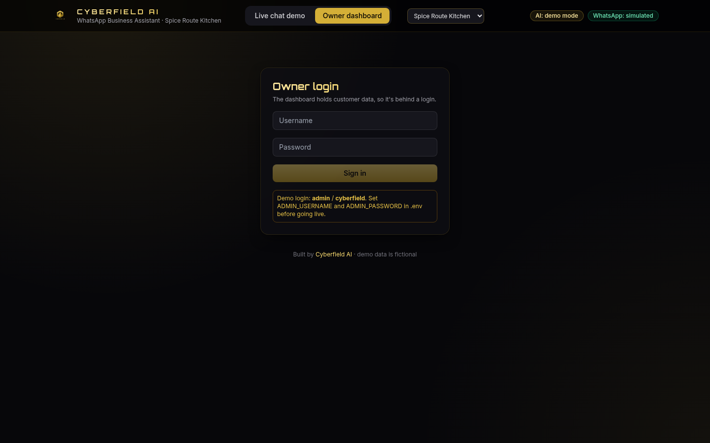 | 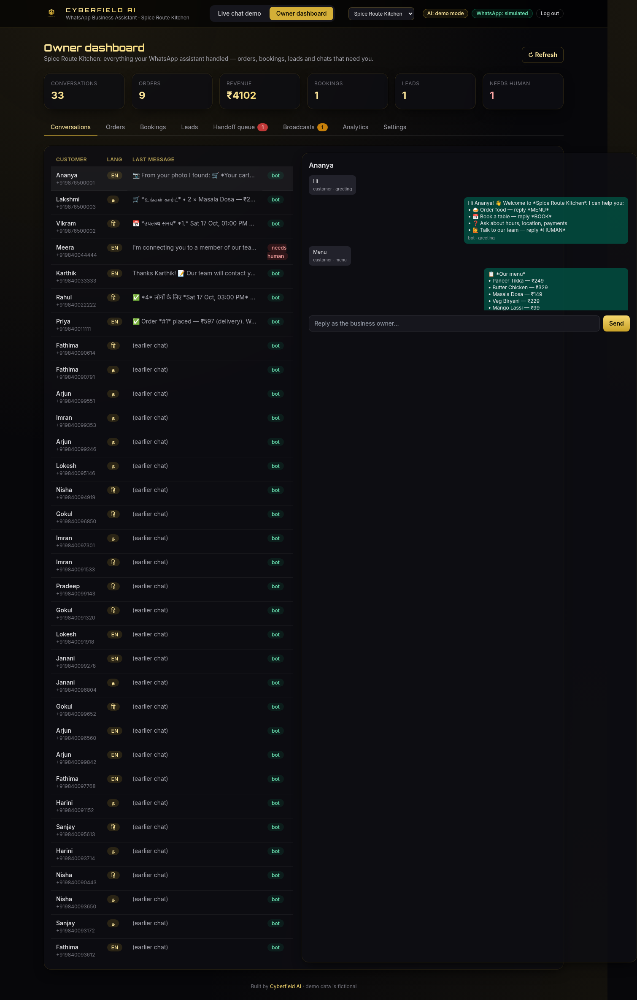 |
| **Orders & payments** | **Bookings & reminders** |
| 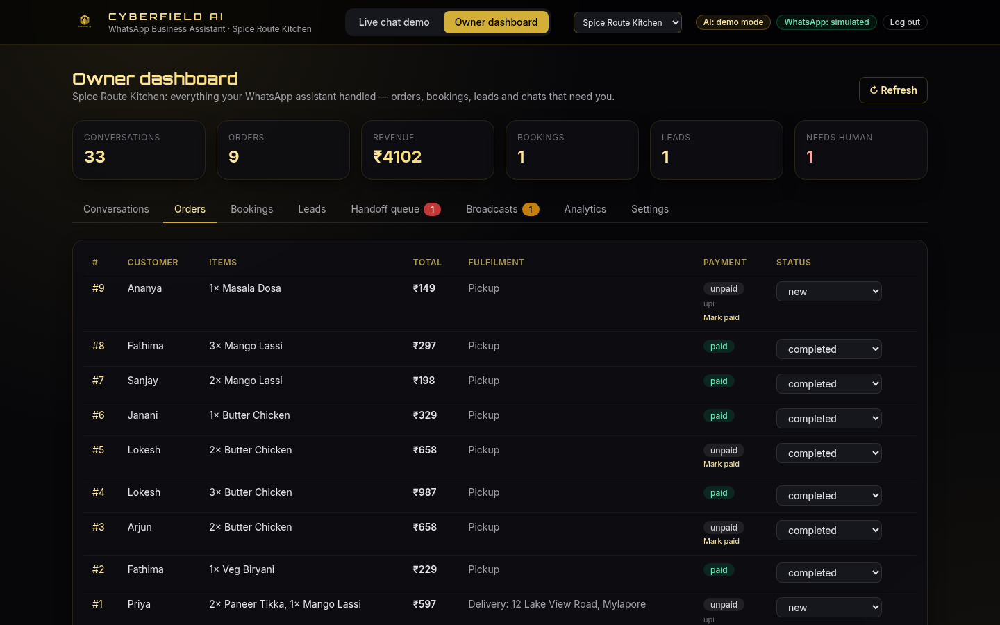 | 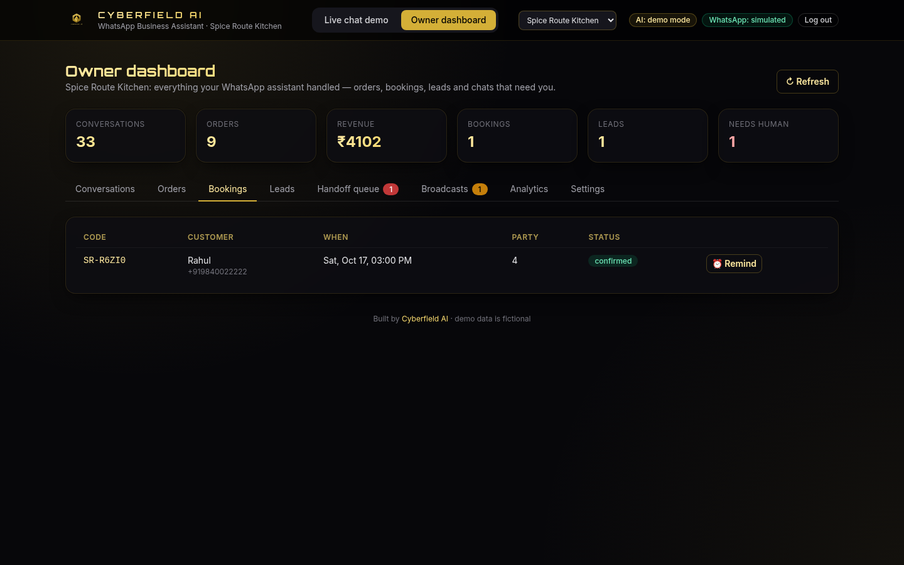 |
| **Handoff queue** | **Broadcasts (approval + templates)** |
| 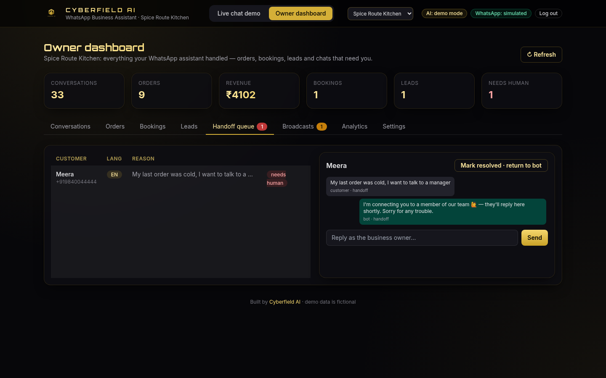 | 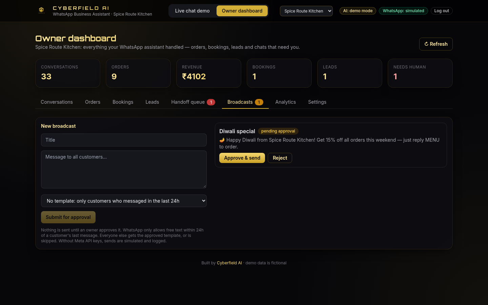 |
| **Settings: FAQ, menu, hours, slots, templates** | **Second tenant: clinic** |
| 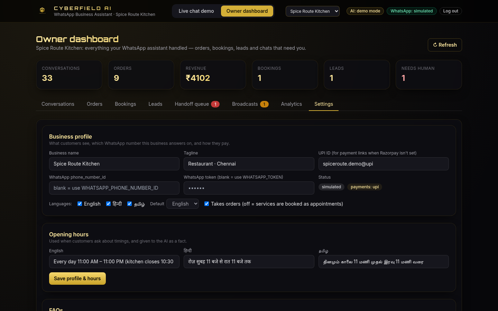 | 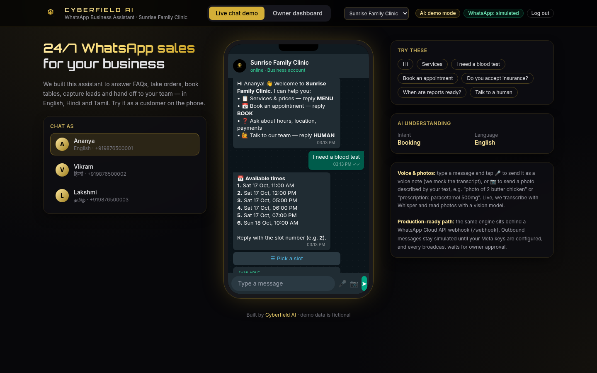 |

## Run it on Windows (about 5 minutes)

You need **Python 3.10+**, **Node.js 18+** and Git.

1. Clone this repo and open the folder.
2. Double-click **`run.bat`**. It creates a virtual environment, installs dependencies, and builds the UI on first run and again whenever the code changes (for example after `git pull`).
3. Open **http://127.0.0.1:8000**. The live chat demo is public; the owner dashboard needs a login (demo: `admin` / `cyberfield` until you set your own).

Or by hand in PowerShell:

```powershell
python -m venv .venv
.venv\Scripts\activate
pip install -r requirements.txt
cd frontend; npm install; npm run build; cd ..
cd backend; python -m uvicorn app.main:app --port 8000
```

For hot reload on the UI, keep the backend running and run `cd frontend; npm run dev`, then open http://localhost:5173.

To reset the demo data, delete the `data` folder or, logged in, `POST /api/reset`. This wipes everything, including your settings.

### Updating an existing install

```powershell
git pull
# add any new variables from .env.example to your .env
run.bat
```

The database upgrades itself on startup. Your existing chats, orders and menu become business #1 (Spice Route Kitchen, which you can rename in Settings), and the clinic and salon demo tenants are added next to it.

## Going live

Copy `.env.example` to `.env` and fill in what you need. Blank means "not set". The app loads `.env` on start.

| Variable | Purpose |
|---|---|
| `WHATSAPP_TOKEN`, `WHATSAPP_PHONE_NUMBER_ID` | Real sending through the Graph API (v20.0) for the default business. Use a **permanent System User token**: see [docs/PERMANENT_TOKEN.md](docs/PERMANENT_TOKEN.md) |
| `WHATSAPP_VERIFY_TOKEN` | Token you enter in the Meta webhook settings (default `cyberfield-demo-token`) |
| `WHATSAPP_APP_SECRET` | Meta app secret. When set, webhook POSTs without a valid `X-Hub-Signature-256` are rejected |
| `WHATSAPP_GRAPH_VERSION`, `WHATSAPP_SEND_RETRIES`, `WHATSAPP_RETRY_BASE_DELAY` | Optional: Graph version (v20.0), send attempts (3), first backoff in seconds (0.5) |
| `ADMIN_USERNAME`, `ADMIN_PASSWORD` | Dashboard login. The password can be plain or a PBKDF2 hash from `python -m app.auth "pw"`. Unset means demo login + a warning in the logs |
| `SESSION_SECRET`, `COOKIE_SECURE` | Cookie signing key (auto-generated if blank), and `true` behind HTTPS |
| `LLM_API_KEY`, `LLM_BASE_URL`, `LLM_MODEL` | Any OpenAI-compatible chat endpoint for the grounded fallback |
| `LLM_VISION_MODEL` | Vision model for photos (defaults to `LLM_MODEL`) |
| `STT_API_KEY`, `STT_BASE_URL`, `STT_MODEL` | Speech-to-text for voice notes (falls back to the LLM key/URL). Groq: `https://api.groq.com/openai/v1` + `whisper-large-v3` |
| `RAZORPAY_KEY_ID`, `RAZORPAY_KEY_SECRET` | Razorpay Payment Links. Without them, orders get a UPI link from the business's UPI ID |
| `RAZORPAY_WEBHOOK_SECRET` | Secret of the Razorpay webhook for `payment_link.paid` at `https://<host>/api/payments/razorpay/webhook` |
| `DB_PATH`, `LOG_FORMAT`, `LOG_LEVEL`, `APP_UTC_OFFSET` | SQLite path, `json`/`text` logs, log level, timezone for analytics (`+05:30`) |

Point the Meta webhook at `https://<your-host>/webhook` and subscribe to **messages**. Status callbacks (sent/delivered/read/failed) arrive on the same webhook. For local testing, ngrok or cloudflared works.

**More businesses:** pick a business in the header dropdown, open **Owner dashboard → Settings**, and enter its WhatsApp `phone_number_id` (and its own token, unless the same System User token covers it). Messages to that number are then answered with that business's data. Tokens are write-only in the UI and never sent back to the browser. Demo businesses without their own number never send from the real one.

**Templates:** create and get templates approved in WhatsApp Manager, then add the exact name and language under Settings → Message templates (purpose `reminder` or `offer`).

## Deploy

One Docker container serves the API, the webhook and the dashboard. SQLite must live on a persistent disk. [docs/DEPLOY.md](docs/DEPLOY.md) covers Render (`render.yaml` blueprint with a disk), Railway (volume) and any VPS (Docker + Caddy).

## Tests

```powershell
python -m playwright install chromium   # first time only
python -m pytest -v                     # or double-click run_tests.bat
```

- `tests/test_api.py`: language detection, FAQ, order, booking, lead, handoff, broadcast approval, webhook verify + inbound.
- `tests/test_reliability.py`: login (demo, env, hashed, tampered cookie), webhook signature, idempotency, status callbacks, send retry/backoff.
- `tests/test_smarter.py`: list/button flows and payload limits, grounded LLM + refusal, voice notes (mock and live-mocked), photos to cart / handoff.
- `tests/test_multitenant.py`: tenant routing by `phone_number_id`, data isolation, clinic booking, settings CRUD, templates + 24h window, UPI and Razorpay (link, signed webhook, idempotent), analytics, upgrade from a v1 database.
- `tests/test_smoke_playwright.py`: browser smoke test of the chat (list + buttons + voice), login, analytics, settings and tenant switch (needs `frontend/dist`).
- `python scripts/screenshots.py` regenerates the README screenshots.

## Project layout

```
backend/app/  main.py (API + webhooks) · engine.py (language, intents, flows) · whatsapp.py (Cloud API, retries, statuses)
              tenants.py · admin.py (settings + analytics) · payments.py · templates.py · media.py (voice/photos)
              llm.py · auth.py · logs.py · seed.py · db.py (SQLite + migrations)
frontend/src/ Vite + React + TypeScript + Tailwind + Recharts: phone simulator, login, dashboard, analytics, settings
docs/         PERMANENT_TOKEN.md · DEPLOY.md · screenshots/
tests/        pytest API tests + Playwright smoke test
```

---
**Cyberfield AI.** We build practical AI automations for small businesses. Want this for your business? Get in touch through our Upwork or Fiverr profile.
